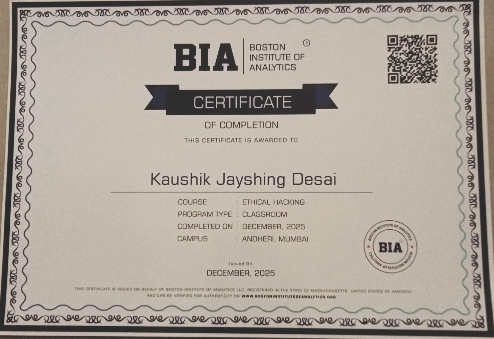
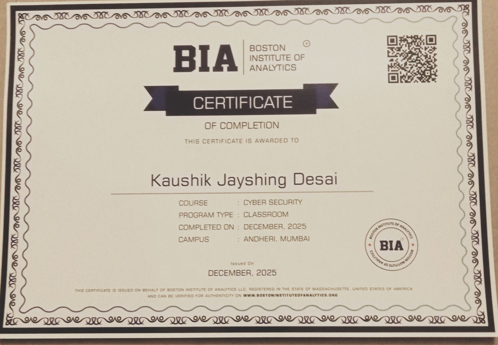

# KAUSHIK DESAI

### CYBERSECURITY ENTHUSIAST | DEVELOPER

---

## 01. About Me

I'm **Kaushik Desai**, a Third-Year B.Sc. Computer Science student at Patkar-Varde College, Mumbai.

I'm interested in cybersecurity, ethical hacking, vulnerability assessment, network security and modern web development.

- Cybersecurity and VAPT enthusiast
- Hands-on security labs and vulnerability research
- Full-stack and freelance project development
- President – Ubuntu, Patkar-Varde College

---

## 02. Technical Arsenal

| Domain | Technologies |
|---|---|
| Cybersecurity | Kali Linux, Burp Suite, Nmap, Wireshark, Metasploit |
| Web Development | HTML, CSS, JavaScript, React, Node.js |
| Programming | Python, Java |
| Database | PostgreSQL, MySQL |
| Infrastructure | Linux, Docker, Git, GitHub |
| Security Learning | Splunk, Microsoft Sentinel, Elastic |

---

## 03. Featured Projects

### 🔐 VulnScanner
A vulnerability assessment platform concept focused on Nmap scanning, CVE intelligence, CVSS scoring and risk reporting.

**Stack:** React · Node.js · PostgreSQL · Nmap

### 🎪 Ubuntu Carnival
A cinematic college festival website with event information, animated visuals and registration integration.

[Visit Website](https://ubuntu-carnival.vercel.app/)

**Stack:** React · Vite · CSS · Vercel

### 🛡️ Cybersecurity Labs
Practical learning through vulnerability analysis, web security exercises and penetration testing labs.

**Stack:** Kali Linux · Burp Suite · Nmap

---

## 04. Featured Certifications

| Ethical Hacking | Cyber Security |
|---|---|
|  |  |
| Boston Institute of Analytics · December 2025 | Boston Institute of Analytics · December 2025 |

### Additional Credentials

- [Introduction to Bug Bounty](public/certificates/introduction-to-bug-bounty.pdf)
- [Foundations of Log Analysis](public/certificates/foundations-of-log-analysis.pdf)
- [Google Cloud Generative AI Studio](public/certificates/google-cloud-generative-ai-studio.pdf)
- [Fundamentals of Game Hacking Development](public/certificates/fundamentals-of-game-hacking-development.pdf)
- [Forage – Data Visualisation](public/certificates/forage-data-visualisation.pdf)
- [Forage – Generative AI Job Simulation](public/certificates/forage-genai-job-simulation.pdf)

---

## 05. Experience & Leadership

- **Cybersecurity Internships:** Two 122-hour internships involving security learning, vulnerability reporting, research and documentation.
- **President – Ubuntu:** Student leadership, event planning and team coordination.
- **Freelance Development:** College projects, websites and application development.

---

## 06. Currently Exploring

- Web Application Penetration Testing
- Vulnerability Assessment and Penetration Testing
- Network Security
- Cloud Security
- SIEM and Security Monitoring
- Secure Full-Stack Development

[TryHackMe](https://tryhackme.com/) · [PortSwigger Academy](https://portswigger.net/web-security)

---

## 07. Let's Connect

Have a project idea or collaboration opportunity? Let's talk.

**KAUSHIK DESAI**

*Think Secure. Build Different.*

